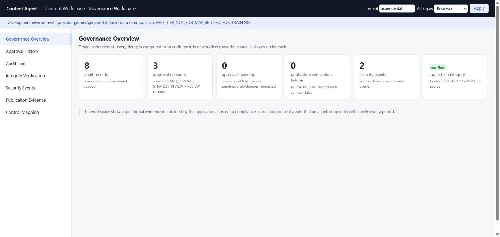
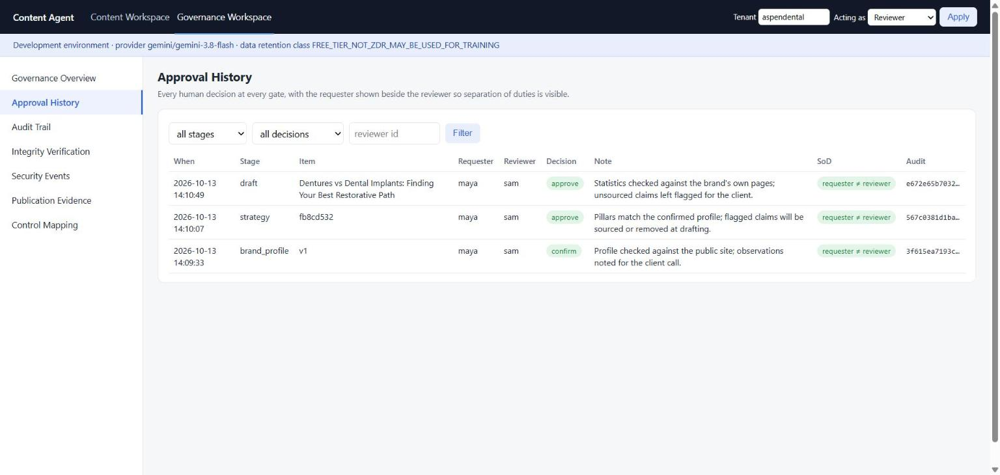
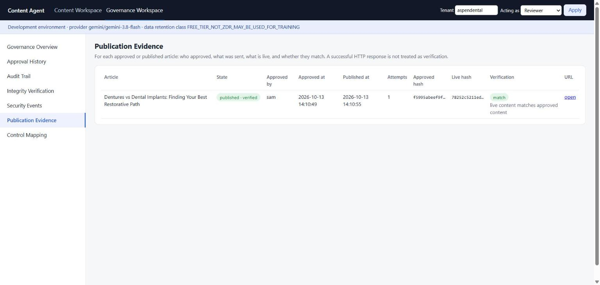
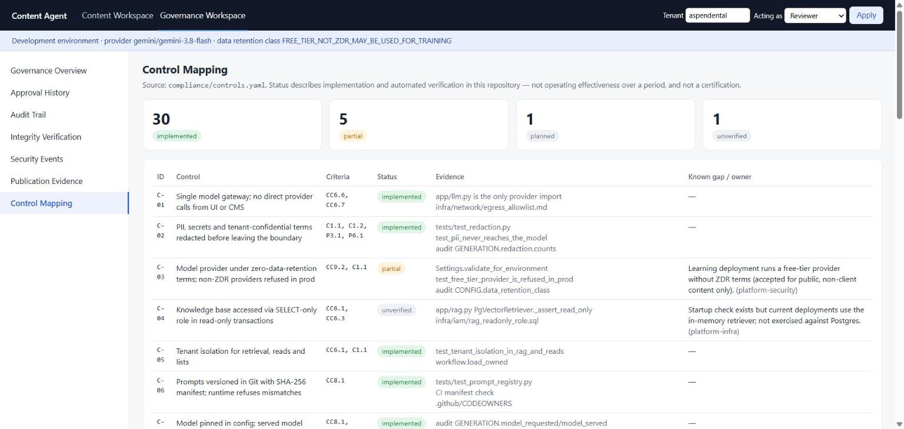

# SOC 2-Aligned AI Marketing Content Agent

**An AI-powered content automation platform combining brand intelligence, SEO/AEO/GEO optimisation, human oversight, secure publishing, and auditable workflows.**

Build, review, and publish brand-aligned marketing content through a structured AI workflow designed with security, accountability, and operational governance in mind.

The platform transforms a brand's website into a structured content foundation, develops a strategic content plan, generates search-optimised content, and publishes approved material to WordPress. Each major stage incorporates human review, while the system maintains a traceable record of decisions and actions.

> **Verified run (12 October 2026):** the complete workflow was exercised end-to-end against live services — a public brand website, a hosted language model, and a WordPress.com site — with every approval gate, the SEO/AEO/GEO validator (100/100 on the published article), read-back verification, and the hash-linked audit trail operating as designed. One publication exception was detected by the verifier, remediated, and re-published in place; the episode is documented under control C-37 in the control matrix.

## Showcase — real runs, real evidence

Two public brands were run through the full pipeline against live services (public website crawl,
hosted model, WordPress.com publishing). Every figure below was produced by the application and is
reproducible from the files in [`docs/showcase/`](docs/showcase/); the rules behind each metric are in
[`docs/showcase/METHODOLOGY.md`](docs/showcase/METHODOLOGY.md).

| Run | Brand analysed | Published article | SEO/AEO/GEO | Words | Read-back verified | Evidence pack |
|---|---|---|---|---|---|---|
| 13 Oct 2026 | [aspendental.com](https://www.aspendental.com) — US dental network | [Dentures vs Dental Implants: Finding Your Best Restorative Path](https://gangadeviai.wordpress.com/2026/10/13/dentures-vs-dental-implants-guide/) | **97 / 100** (21 of 22 checks) | 716 | ✅ | [`docs/showcase/aspendental/`](docs/showcase/aspendental/) |
| 12 Oct 2026 | [firepencil.ai](https://firepencil.ai) — AEO SaaS | [Beyond Traditional SEO: Why Brands Must Adapt to Autonomous Answer Engine Optimization](https://gangadeviai.wordpress.com/2026/10/12/autonomous-answer-engine-optimization-guide/) | **100 / 100** (22 of 22) | 619 | ✅ after one flagged, remediated attempt | [`docs/showcase/learn/`](docs/showcase/learn/) |

What the evidence shows, beyond the score:

- **Human gates operated:** three approvals per run (brand profile, strategy, article), each by a reviewer who was not the requester, each with a note and an audit hash.
- **Honest model lineage:** during the Aspen Dental run the primary model was saturated; the brand profile records `model_served = gemini-3.1-flash-lite` with a `MODEL_FALLBACK` flag, while the article records `gemini-3.8-flash`. Nothing is attributed to a model that did not produce it.
- **Exceptions on the record:** the first FirePencil publish failed read-back verification (WordPress.com stripped the JSON-LD script); the fix and the in-place re-publish are both in the audit chain and under control C-37. The Aspen Dental article's one failed check (`entities_named_in_body`) is shown to the reviewer rather than hidden.
- **Integrity verified:** the audit chain re-hashed cleanly (35 records at the time of export) and the live post hash matched the approved hash.

<p align="center">
  
  
  
  
</p>

## Project Highlights

- **End-to-end content automation:** Connect brand analysis, content strategy, AI-assisted writing, editorial review, and WordPress publishing in one workflow.
- **SEO, AEO, and GEO optimisation:** Evaluate content for traditional search engines, answer engines, and generative AI search experiences.
- **Human-in-the-loop governance:** Require explicit reviewer approval at critical workflow stages.
- **Security-conscious architecture:** Incorporate scoped website crawling, prompt-injection screening, confidential-term redaction, and tenant-specific configuration.
- **Auditable operations:** Maintain hash-linked audit records and support verification of workflow history.
- **Multi-tenant design:** Separate brand configuration, content context, and publishing credentials by client.
- **Reproducible AI workflows:** Use version-controlled prompts, model configuration records, and structured model outputs.
- **Flexible execution modes:** Support simulated demonstrations, automated testing, real-service development, and production-oriented operation.

## Architecture

The platform follows a four-stage workflow.

```text
Brand Website
      |
      v
1. BRAND ANALYSIS
   Scoped crawling and profile generation
      |
      v
   Human Confirmation
      |
      v
2. CONTENT STRATEGY
   Objectives, content planning and claim screening
      |
      v
   Human Approval
      |
      v
3. CONTENT GENERATION
   Retrieval, LLM generation and quality validation
      |
      v
   Human Approval
      |
      v
4. PUBLISHING
   WordPress integration and read-back verification
      |
      v
   Publication Status and Audit Records

All stages contribute to a traceable audit history.
```

The architecture centralises model interactions through a shared gateway. This supports consistent redaction, model configuration, prompt management, structured outputs, and audit recording across the application.

## Core Capabilities

### 1. Brand Intelligence

Analyse a configured public website and construct a structured brand profile that provides the foundation for subsequent content planning.

Key capabilities include:

- Domain-scoped crawling, with crawl targets defined in version-controlled configuration rather than in API requests.
- Respect for website crawling policies (robots.txt) and an identifying User-Agent.
- Server-side request forgery (SSRF) safeguards.
- Confidential-term and personal-data redaction.
- Prompt-injection screening of retrieved pages.
- Human confirmation of the generated brand profile.

The confirmed profile becomes the starting point for brand-specific content development.

### 2. Strategic Content Planning

Generate a structured content strategy based on the confirmed brand profile, business objectives, and available tenant-specific knowledge.

The strategy workflow supports:

- Content planning over a configurable time horizon.
- Strategy approval before content generation.
- Screening of claims associated with proposed content.
- Draft generation from approved strategy items.
- Traceability between strategy decisions and generated content.

### 3. AI-Powered Content Generation

Generate structured marketing content through a controlled language-model gateway.

The workflow incorporates retrieval-augmented generation (RAG), configurable model access, prompt versioning, redaction, and output screening.

Generated content includes:

- Search-optimised titles and meta descriptions.
- Content headlines and URL slugs.
- Primary and secondary keywords.
- Structured headings and article body text.
- Direct-answer sections.
- Frequently asked questions.
- Key takeaways.
- Sourced factual claims.
- Schema.org structured data.

Generated material remains subject to human review before publication.

### 4. SEO, AEO, and GEO Quality Validation

The platform evaluates generated content against a deterministic set of content-quality criteria, so the model never grades its own output.

| Optimisation area | Validation focus |
|---|---|
| SEO — Search Engine Optimisation | Title and meta-description lengths, keyword placement, headings, content structure, word count, alt text, and sentence length |
| AEO — Answer Engine Optimisation | Direct-answer sections, FAQ structure, and key takeaways |
| GEO — Generative Engine Optimisation | Brand and named entities, source-backed facts, and structured data |

The validator produces a score from 0 to 100. Drafts scoring below 70 are flagged for reviewer attention. Validation findings are recorded in the generation audit record, allowing reviewers to assess the output before publication.

### 5. Human Review and Approval

Human oversight is an integral part of the workflow rather than an optional final check.

The principal approval stages cover:

1. Confirmation of the generated brand profile.
2. Approval of the content strategy.
3. Approval of generated content.
4. Explicit initiation of publication.

The system also requires reviewer and requester identities to differ at each approval gate, supporting separation of duties. Approvals carry a verification note, and refused actions are recorded alongside successful ones.

### 6. WordPress Publishing

Publish approved content through the WordPress REST API using tenant-specific credentials.

Publishing capabilities include:

- Dedicated publishing credentials for each tenant, used only on the publish path.
- Support for self-hosted WordPress (application passwords) and WordPress.com (OAuth).
- Support for configured SEO plugins, including Yoast SEO and Rank Math.
- Transfer of approved content, slugs, and excerpts.
- Integration of FAQ content and supported structured data.
- Read-back verification of published content.
- In-place re-publication when verification identifies a discrepancy.
- Explicit publication status and audit records.

Publication verification identifies cases where the final WordPress output differs from the approved content, including situations where structured data is removed during publishing.

### 7. Security, Governance, and Auditability

The project incorporates security and governance mechanisms informed by the SOC 2 Trust Services Criteria (2017 criteria with the 2022 points of focus) and the AI-specific evidence that auditors request in current examinations.

Key controls include:

- Tenant-aware authentication and authorisation.
- Role-based workflow permissions.
- Confidential-term and personal-data redaction before model calls.
- Prompt-injection screening.
- Restricted crawling and network egress controls.
- Version-controlled prompts with integrity verification at start-up.
- Pinned model configuration with the served model recorded per request.
- Hash-linked audit records with chain verification.
- Production start-up checks.
- Documented AI inventory, risk register, vendor assessments, monitoring thresholds, and incident-response procedures.

The compliance documentation maps 37 implemented controls, and the remaining planned items, to the relevant criteria — supporting further engineering, operational validation, and compliance preparation.

**Compliance scope:** This is a SOC 2-aligned engineering and learning project. Its architecture and documentation support control implementation and evaluation; they do not, by themselves, constitute an independent SOC 2 Type II attestation.

## Technology Stack

The repository is primarily implemented in Python, with supporting HTML and infrastructure configuration.

| Component | Purpose |
|---|---|
| Python 3.11+ | Application logic and workflow orchestration |
| FastAPI | API endpoints and interactive demonstration interface |
| Large language models | Brand analysis, strategic planning, and content generation |
| Retrieval-augmented generation | Access to relevant tenant-specific context |
| WordPress REST API | Content publication and verification |
| PyJWT | JWT-based authentication |
| SQLAlchemy | Workflow persistence |
| Pytest | Automated control and application testing |
| Docker Compose | Optional local WordPress development environment |
| Terraform | Infrastructure configuration |
| Amazon S3 Object Lock | Tamper-resistant audit storage |

### Model Provider Options

The gateway supports two providers through a single configuration setting (`AGENT_PROVIDER`).

| Provider | Suited to | Notes |
|---|---|---|
| Google AI Studio (Gemini) | Learning, demonstrations, and public-brand content at no cost | Standard free-tier data-retention terms; the application records this in the audit log and restricts the provider to non-production environments |
| Anthropic (Claude) | Client work and production | Zero-data-retention configuration available; the provider assumed by the production start-up checks |

## Workspaces

The interface is split into two destinations with a shared top navigation.

| Workspace | Route | Audience | What it shows |
|---|---|---|---|
| **Content Workspace** | `/demo?tenant=<tenant>` | Requesters, reviewers | The four-stage workflow: brand analysis, strategy, drafting with the SEO/AEO/GEO score, review and publication, plus "try to break it" actions that exercise the controls |
| **Governance Workspace** | `/governance?tenant=<tenant>` | Reviewers, administrators, compliance stakeholders | Operational evidence: overview metrics (each with its source), approval history with requester and reviewer side by side, the hash-chained audit trail with record detail, explicit integrity verification (not performed / verified / failed / unavailable), security events derived from recorded audit events, publication evidence (approved → published → verified), and the control mapping read from `compliance/controls.yaml` |

Access is enforced server-side: reviewers can read approvals and publication evidence for their tenant; administrators additionally read the audit trail, security events and system records; any authenticated user can read the control mapping. Everything is tenant-scoped, outputs are allow-listed field by field, and viewing never writes audit records. In `demo` and `test` modes the Governance Workspace shows a visible **SIMULATED DATA** banner.

## Execution Modes

The application supports different execution modes to accommodate demonstrations, testing, development, and production deployment.

| Mode | Environment | Intended purpose |
|---|---|---|
| `demo` | Simulated model, website, and WordPress | Interactive demonstrations, training, and workflow walkthroughs |
| `test` | Simulated dependencies | Automated tests and control verification |
| `dev` | Real model and website; real WordPress when credentials are configured | Integration development and client-site testing |
| `prod` | Real integrations with production security requirements | Production-oriented deployment |

Simulated environments allow the complete workflow to be explored without requiring live external services. Development and production modes use real integrations when the required credentials and configuration are provided.

## Getting Started

### Prerequisites

- Python 3.11+ and pip.
- Git.
- For real-model development: a Google AI Studio or Anthropic API key.
- For live publishing: a WordPress.com site (no installation required) or a self-hosted WordPress with an application password. Docker Compose is provided for an optional local WordPress.

### 1. Clone the Repository

```bash
git clone https://github.com/gangadeviai/soc2-content-agent.git
```

```bash
cd soc2-content-agent
```

### 2. Install Dependencies

```bash
pip install -e ".[dev]"
```

### 3. Configure the Environment

Copy the example environment file:

```bash
cp .env.example .env
```

Configure the required settings for your selected execution mode. Keep credentials in environment variables or a secrets manager; never commit real API keys, application passwords, or production secrets to Git.

### 4. Run the Demonstration Environment

```bash
python scripts/run_demo.py
```

Open the interactive demonstration interface at `http://localhost:8000/demo`.

The demonstration environment uses simulated dependencies to let you explore the workflow, approval gates, security controls, and audit functionality.

For a terminal-based walkthrough that prints each control as it operates:

```bash
python scripts/demo_walkthrough.py
```

### 5. Run the Application in Development Mode

Configure the model credentials in `.env`, add the brand to `tenants/brands.yaml`, then start the application:

```bash
uvicorn app.main:app --reload
```

Access the interactive interface at `/demo?tenant=<tenant>` or the API documentation at `/docs`.

For live WordPress publishing, configure the tenant's publishing credentials (`AGENT_WP_USER__<TENANT>` / `AGENT_WP_APP_PASSWORD__<TENANT>`) and the `wordpress_url` in `tenants/brands.yaml`. The interface includes a one-click capture step for the WordPress.com OAuth flow.

### 6. Run the Tests

```bash
pytest -q
```

The test suite evaluates application behaviour and security-related controls using simulated dependencies where appropriate.

## Project Structure

```text
soc2-content-agent/
├── app/
│   ├── main.py            # FastAPI application and routes
│   ├── brand.py           # Brand analysis and profile workflow
│   ├── strategy.py        # Content strategy and planning
│   ├── workflow.py        # Draft generation, review and publication workflow
│   ├── seo.py             # SEO / AEO / GEO validation
│   ├── cms.py             # WordPress integration
│   ├── llm.py             # Language-model gateway and provider adapters
│   ├── prompts.py         # Versioned prompt registry with integrity checks
│   ├── redaction.py       # Confidential-term and personal-data handling
│   ├── injection.py       # Prompt-injection and output screening
│   ├── rag.py             # Retrieval-augmented generation
│   ├── audit.py           # Audit records and chain verification
│   ├── auth.py            # Authentication and authorisation
│   ├── models.py          # Persistence models
│   ├── config.py          # Settings and production start-up checks
│   ├── demo_data.py       # Simulated website used by demo and tests
│   └── static/demo.html   # Interactive demonstration interface
├── compliance/
│   ├── SOC2_CONTROL_MATRIX.md
│   ├── SYSTEM_DESCRIPTION.md
│   ├── AI_INVENTORY.yaml
│   └── ...                # Risk register, vendor assessment, monitoring, incident response, policy
├── infra/                 # Infrastructure and security configuration
├── prompts/               # Versioned prompts and manifest
├── scripts/               # Demonstrations and utility scripts
├── tenants/               # Brand and tenant configuration
├── tests/                 # Automated tests
├── .github/               # CI workflows and repository controls
├── .env.example
├── .gitleaks.toml
├── docker-compose.wordpress.yml
├── LEARNING.md
├── README.md
└── pyproject.toml
```

## Production Readiness

Production deployment requires explicit configuration and verification of the relevant security and operational controls.

The application includes start-up checks for key production requirements, including zero-data-retention confirmation, configured Object Lock storage, a non-default JWT secret, a production-appropriate database, and a production-eligible model provider.

Before production deployment:

- Configure an AI provider and model with suitable data-retention terms.
- Verify all authentication and authorisation controls.
- Integrate identity-provider verification using JWKS/RS256.
- Configure secure storage and encryption for sensitive data.
- Configure audit-log retention and protected storage.
- Review tenant isolation, database permissions, and network egress.
- Establish monitoring, incident response, and retention procedures.
- Review all documented control gaps and assign remediation responsibilities.

Provider eligibility, contractual requirements, and deployment configuration must be verified independently before processing confidential client information.

## Learning and Documentation

The repository includes supporting materials for understanding the design decisions and control implementation.

- `LEARNING.md` — learning guide: SOC 2 Type II concepts mapped to this codebase, and how to practise an observation period.
- `compliance/SOC2_CONTROL_MATRIX.md` — control mapping, implementation status, and field notes.
- `compliance/SYSTEM_DESCRIPTION.md` — system description in the structure auditors expect.
- `compliance/AI_INVENTORY.yaml` — AI system inventory.
- `compliance/` — risk register, vendor assessment, model registry, monitoring thresholds, incident-response playbook, acceptable-use policy, and evidence schedule.
- `tests/` — automated tests covering application and control behaviour.

## Project Objectives

This project explores how AI-driven content production can be combined with structured human oversight, tenant isolation, security controls, and auditable operations.

Its primary objectives are to:

1. Automate repetitive marketing content workflows without removing human accountability.
2. Improve the consistency of SEO, AEO, and GEO content validation.
3. Establish traceability between AI-generated outputs, reviewer decisions, and publishing actions.
4. Apply security engineering principles to AI-assisted content operations.
5. Provide a practical foundation for evaluating governance and compliance controls in AI-agent systems.

## Disclaimer

This repository is an engineering and learning project. The presence of documented or implemented controls does not guarantee regulatory compliance, eliminate security risks, or establish independent certification. Production use requires deployment-specific testing, security review, and appropriate compliance assessment.

## License

Released under the [MIT License](LICENSE). You may use, modify, and distribute this software, including commercially, provided the copyright and licence notice are retained.
